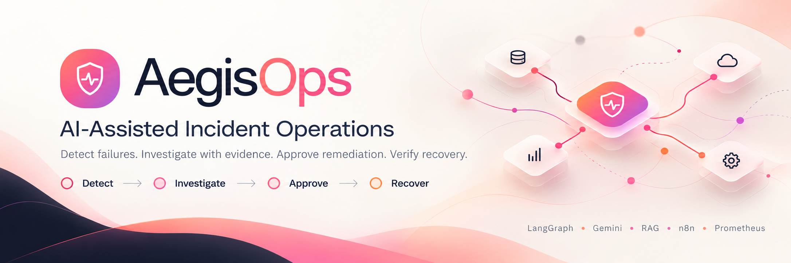
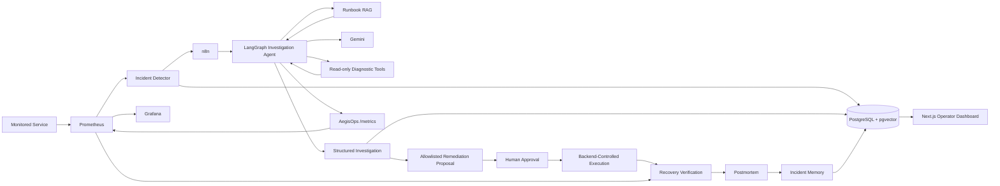

<p align="center">
  
</p>

<p align="center">
  <strong>Evidence-grounded incident investigation, human-controlled remediation, independent recovery verification, and reusable operational memory.</strong>
</p>

<p align="center">
  
  
  
  
  
  
  
  
</p>

---

## What is AegisOps?

**AegisOps** is an AI-assisted incident operations platform designed to move an incident from detection to verified recovery without giving the model direct infrastructure authority.

It combines deterministic monitoring, LangGraph-based investigation, RAG over operational runbooks, read-only diagnostic tools, human approval, allowlisted remediation, recovery verification, postmortems, and incident memory into one auditable workflow.

```text
Detect
  → Investigate
  → Retrieve evidence
  → Diagnose
  → Propose remediation
  → Human approval
  → Execute allowlisted action
  → Verify recovery independently
  → Generate postmortem
  → Store reusable incident memory
```

> **Current status:** Core platform and local validation complete.
> **Now:** Phase 17 — Connector Architecture
> **Next:** AWS and Velora real-world integrations.

---

## Operator Experience

AegisOps includes a dedicated Next.js operator dashboard for the incident lifecycle.

<p align="center">
  
</p>

The operator can inspect:

- current service health and open incidents
- saved LangGraph investigations
- remediation proposals and human-review state
- execution and recovery results
- deterministic incident timelines
- generated postmortems and incident memory

The dashboard is a **control surface**, not a second source of business logic. FastAPI and PostgreSQL remain authoritative.

---

## Why AegisOps Is More Than an LLM Demo

AegisOps intentionally separates model reasoning from operational authority.

### Agentic investigation

A checkpointed LangGraph agent can gather evidence iteratively using a small read-only tool catalog:

```text
get_incident
get_metric
get_service_logs
```

The agent is bounded by tool-round and total-call budgets, and its structured report is validated before persistence.

### RAG + historical incident memory

Investigation context combines:

```text
runbook vector retrieval
→ cross-encoder reranking
→ bounded context selection
+
similar historical incident memories
```

Historical similarity is treated as supporting context only — never as proof that the current incident has the same root cause.

### Human-controlled remediation

The model can propose an action, but it cannot directly execute infrastructure changes.

```text
AI proposes.
Human approves.
Backend validates.
Backend executes only a predefined action.
Monitoring independently verifies recovery.
```

### Independent recovery verification

A successful command is **not** treated as proof of recovery.

AegisOps rechecks the original monitoring condition and requires healthy observations before an incident is marked recovered.

```text
VERIFYING
RECOVERED
NOT_RECOVERED
INCONCLUSIVE
```

---

## Architecture



The current benchmark environment is intentionally separate from the AegisOps core. Phase 17 moves benchmark-specific telemetry, log access, remediation, and recovery behavior behind connector contracts so the same core can support AWS, Velora, and future systems.

---

## Workflow Orchestration

AegisOps uses **n8n** for workflow coordination while keeping state and authorization in the backend.

### 1. Incident Orchestration

The first workflow receives newly detected incidents, routes them by severity, rechecks the authoritative incident state, skips incidents that already recovered, and forwards active incidents into the shared investigation workflow.

```text
New OPEN incident
→ severity routing
→ live incident recheck
→ recovered? skip
→ still open? investigation intake
```

<p align="center">
  
</p>

### 2. Investigation Intake

The investigation workflow coordinates the longer incident-response lifecycle:

```text
LangGraph investigation
→ persist investigation
→ create remediation proposal
→ wait for human approval
→ protected execution
→ recovery verification
→ postmortem generation
→ incident-memory creation
```

<p align="center">
  
</p>

n8n orchestrates the process, but it does not become the source of truth for approval, execution authorization, recovery state, or incident memory.

---

## Evaluation & Agent Observability

AegisOps includes deterministic evaluation for persisted investigations rather than relying only on subjective LLM judging.

The evaluator checks areas such as:

```text
report schema validity
incident/evidence consistency
runbook-source grounding
tool allowlist compliance
incident scope enforcement
tool budget compliance
tool execution health
confidence/evidence consistency
golden-case expectations
```

A verified golden-case run produced:

```text
Score: 0.9333
Passed: 14 / 15 checks
Result: PASS
```

Runtime behavior is exported through FastAPI at:

```text
GET /metrics
```

and scraped by Prometheus.

The dedicated **AegisOps Agent Observability** Grafana dashboard tracks:

```text
investigation runs and duration
Gemini calls and latency
diagnostic tool calls
tool rounds
budget exhaustion
RAG context size
historical-memory usage
```

<p align="center">
  
</p>

This gives AegisOps two separate views:

| Surface | Purpose |
|---|---|
| **Next.js Operator Dashboard** | Incidents, investigations, approvals, recovery, postmortems |
| **Grafana** | Infrastructure and agent engineering telemetry |

---

## Core Capabilities

| Area | Implementation |
|---|---|
| **Detection** | Deterministic Prometheus rules with incident deduplication |
| **Investigation** | Checkpointed LangGraph agent with Gemini |
| **Knowledge** | pgvector RAG + local embeddings + cross-encoder reranking |
| **Diagnostics** | Validated, read-only, allowlisted tool calling |
| **Remediation** | Human-approved, backend-controlled, predefined actions |
| **Recovery** | Independent monitoring-based verification |
| **Learning** | Structured postmortems + vectorized incident memory |
| **Evaluation** | Deterministic checks + golden incident cases |
| **Observability** | Prometheus metrics + Grafana agent dashboard |
| **Operator UI** | Next.js dashboard with server-side backend credentials |
| **Orchestration** | n8n incident and investigation workflows |

---

## Tech Stack

| Layer | Technologies |
|---|---|
| **Backend** | Python 3.12, FastAPI, Pydantic, psycopg |
| **Agent / AI** | LangGraph, Gemini, SentenceTransformers |
| **Data** | PostgreSQL 16, pgvector, Redis |
| **RAG** | Local embeddings, vector search, cross-encoder reranking |
| **Automation** | n8n |
| **Observability** | Prometheus, Grafana, cAdvisor, prometheus-client |
| **Frontend** | Next.js 16, React 19, TypeScript, Tailwind CSS |
| **Infrastructure** | Docker, Docker Compose |

---

## Current Failure Scenarios

The local benchmark environment provides controlled failures for:

```text
PostgreSQL unavailable
Redis unavailable
HTTP 5xx rate elevated
API P95 latency elevated
```

These provide known test conditions without pretending the benchmark environment is production infrastructure.

The next integration stages move AegisOps toward real deployed systems through connector-based telemetry and remediation.

---

## Project Status

```text
✅ Project foundation
✅ Breakable benchmark environment
✅ Monitoring and telemetry
✅ Deterministic incident detection
✅ n8n workflow orchestration
✅ Gemini investigation
✅ Embeddings + knowledge base
✅ RAG + reranking
✅ Controlled tool calling
✅ LangGraph investigation agent
✅ Human-in-the-loop remediation
✅ Automated allowlisted execution
✅ Recovery verification
✅ Postmortem + incident memory
✅ Next.js operator dashboard
✅ Evals + agent observability

🚧 Connector architecture
⏳ AWS integration + real test case
⏳ Velora integration + real test case
⏳ Final hardening + portfolio packaging
```

---

## Quick Start

### 1. Start infrastructure

```powershell
docker compose up -d --build
```

### 2. Start the backend

```powershell
cd backend
.\venv\Scripts\Activate.ps1
pip install -r requirements.txt
uvicorn app.main:app --reload
```

### 3. Start the operator dashboard

```powershell
cd dashboard
npm install
npm run dev -- -p 3001
```

### 4. Start n8n

Publish the two workflows:

```text
AegisOps Incident Orchestration
AegisOps Investigation Intake
```

Typical local services:

```text
AegisOps API         http://127.0.0.1:8000
Operator Dashboard   http://localhost:3001
Benchmark API        http://127.0.0.1:8001
Grafana              http://127.0.0.1:3000
Prometheus           http://127.0.0.1:9090
n8n                  http://127.0.0.1:5678
```

> Local secrets and credentials belong in untracked environment files. Do not commit API keys, operator credentials, remediation keys, or signed callback URLs.

---

## Documentation

The main README is intentionally portfolio-focused.

Detailed implementation history, architecture decisions, validation steps, and phase-specific screenshots are available under:

```text
docs/phases/
docs/runbooks/
docs/screenshots/
```

Latest completed phase:

- [Phase 16 — Evals & Observability](docs/phases/phase-16-evals-observability.md)

Previous major milestones:

- [Phase 10 — LangGraph Investigation Agent](docs/phases/phase-10-langgraph-investigation-agent.md)
- [Phase 11 — Human-in-the-Loop Remediation](docs/phases/phase-11-human-in-the-loop-remediation.md)
- [Phase 12 — Automated Remediation](docs/phases/phase-12-automated-remediation.md)
- [Phase 13 — Recovery Verification](docs/phases/phase-13-recovery-verification.md)
- [Phase 14 — Postmortem & Incident Memory](docs/phases/phase-14-postmortem-incident-memory.md)
- [Phase 15 — Operator Dashboard](docs/phases/phase-15-operator-dashboard.md)

---

## Roadmap

```text
Phase 17 — Connector Architecture
Phase 18 — AWS Integration & Real Test Case
Phase 19 — Velora Integration & Real Test Case
Phase 20 — Hardening & Portfolio Packaging
```

AegisOps is moving from a fully validated local incident-response platform toward connector-based real-world integrations.
