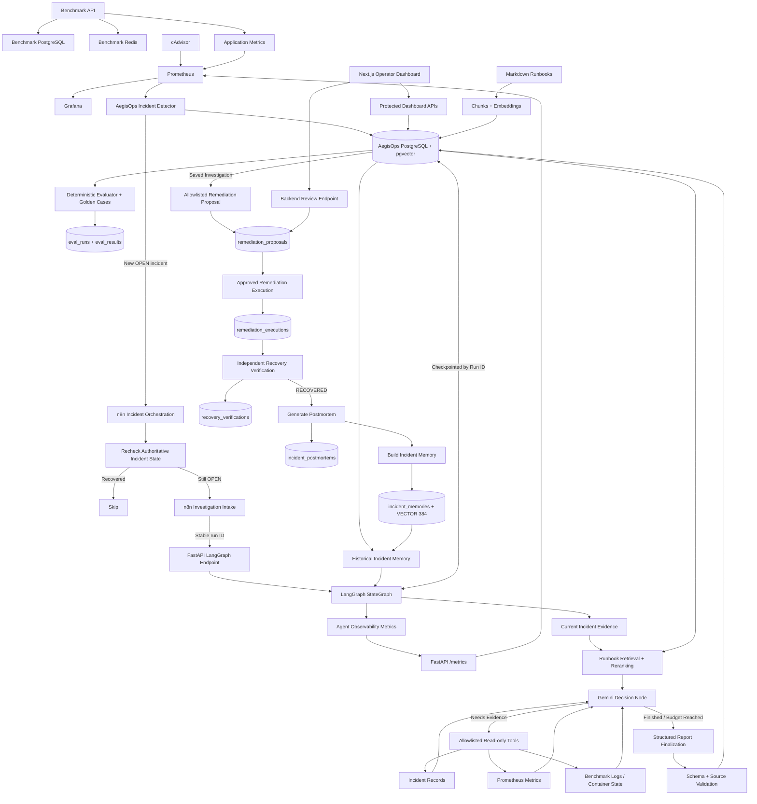

# AegisOps

AegisOps is a modular AI-assisted incident operations platform built to detect service failures, gather evidence, investigate incidents with a checkpointed LangGraph agent, propose human-approved remediation, execute only allowlisted recovery actions, independently verify recovery, and convert resolved incidents into reusable operational memory.

The project is developed incrementally so each architectural layer is implemented and verified before higher-level automation is added.

> **Current status:** Phase 16 complete — Evals & Observability
> **Next phase:** Phase 17 — Connector Architecture
> **Roadmap:** 17 of 21 phases complete (Phases 0–16)

---

## Current Architecture



The benchmark environment is deliberately separate from the AegisOps core. It produces controlled failures and telemetry; AegisOps consumes those signals and persists incident, investigation, approval, execution, recovery, postmortem, memory, and evaluation state independently.

The remediation boundary remains strict:

```text
AI proposes.
Human approves.
Backend validates.
Backend executes only a predefined action.
Monitoring independently verifies recovery.
Postmortem generation happens only after confirmed recovery.
```

The Next.js dashboard is the operator-facing control surface. Grafana is the engineering observability surface. n8n orchestrates workflow progression, while FastAPI and PostgreSQL remain authoritative for state and authorization.

---

## Completed Phases

| Phase | Status | Outcome |
|---|---|---|
| Phase 0 — Project Foundation | ✅ Complete | Git/GitHub, FastAPI, PostgreSQL, pgvector, Docker, Compose, configuration, DB connectivity |
| Phase 1 — Benchmark Environment | ✅ Complete | Breakable FastAPI target with dedicated PostgreSQL, Redis, real operations, and controlled failures |
| Phase 2 — Monitoring & Telemetry | ✅ Complete | Prometheus, cAdvisor, Grafana, HTTP metrics, latency, 5xx rate, dependency health, container telemetry |
| Phase 3 — Incident Detection Engine | ✅ Complete | Deterministic Prometheus rules, incident persistence, deduplication, severity, automatic resolution |
| Phase 4 — Advanced Workflow Orchestration | ✅ Complete | Production webhook, severity routing, live incident recheck, retries, recovery skip, shared investigation intake |
| Phase 5 — LLM Investigation v1 | ✅ Complete | Gemini structured investigation, Prometheus evidence snapshot, PostgreSQL report history, n8n hand-off |
| Phase 6 — Embeddings & Knowledge Base | ✅ Complete | CPU-based 384-dimensional embeddings, pgvector schema, duplicate-safe document ingestion |
| Phase 7 — RAG Pipeline | ✅ Complete | Heading-aware chunks, pgvector retrieval, bounded context selection, validated runbook references |
| Phase 8 — Reranking & Context Engineering | ✅ Complete | Cross-encoder reranking, duplicate-free context, excerpt budget, persisted retrieval/rerank scores |
| Phase 9 — Tool Calling Layer | ✅ Complete | Read-only incident/metric/log tools, validated allowlists, bounded Gemini tool loop |
| Phase 10 — LangGraph Investigation Agent | ✅ Complete | Stateful investigation graph, PostgreSQL checkpointing, conditional tool loop, budget-aware persistence |
| Phase 11 — Human-in-the-Loop Remediation | ✅ Complete | Allowlisted proposals, auditable review decisions, authenticated human approval |
| Phase 12 — Automated Remediation | ✅ Complete | Backend-controlled execution, callback-driven approval, execution audit, idempotent retry protection |
| Phase 13 — Recovery Verification | ✅ Complete | Bounded monitoring-based verification, two consecutive healthy checks, terminal recovery outcomes, incident resolution |
| Phase 14 — Postmortem & Incident Memory | ✅ Complete | Deterministic lifecycle reconstruction, grounded postmortems, 384-dimensional incident memories, pgvector similarity retrieval |
| Phase 15 — Operator Dashboard | ✅ Complete | Next.js operations dashboard, live health, incident history/detail, investigations, remediation approval, recovery visibility, postmortems |
| Phase 16 — Evals & Observability | ✅ Complete | Deterministic investigation evaluation, golden cases, persisted eval results, LangGraph/Gemini/tool/RAG metrics, Prometheus integration, Grafana agent observability |

---

## Phase Highlights

### Monitoring and Detection

Prometheus collects benchmark application metrics and cAdvisor container telemetry. AegisOps evaluates deterministic incident rules for:

```text
PostgreSQL unavailable
Redis unavailable
HTTP 5xx rate elevated
P95 API latency elevated
```

A fingerprint based on `service + rule_key` prevents duplicate OPEN incidents.

### Evidence-Grounded Investigation

An OPEN incident can progress through:

```text
current incident evidence
→ runbook vector retrieval
→ cross-encoder reranking
→ historical incident-memory retrieval
→ Gemini decision node
→ bounded read-only diagnostic tools
→ structured report finalization
→ PostgreSQL persistence
```

Gemini can request only the fixed diagnostic catalog:

```text
get_incident
get_metric
get_service_logs
```

### Human-in-the-Loop Remediation

For every remediation execution, FastAPI revalidates:

```text
proposal status
authorization state
incident state
allowlisted action
exact target
```

Gemini and n8n never provide arbitrary shell commands.

### Recovery Verification

Execution success and service recovery are separate states.

Recovery verification supports:

```text
VERIFYING
RECOVERED
NOT_RECOVERED
INCONCLUSIVE
```

### Postmortem and Incident Memory

Resolved incidents produce a deterministic lifecycle reconstruction before Gemini generates a structured postmortem.

Reusable incident memory is embedded with:

```text
sentence-transformers/all-MiniLM-L6-v2
dimensions = 384
```

Historical similarity is reference material only, not proof of root cause.

### Operator Dashboard

The Next.js operator UI exposes:

```text
live operations overview
service health
incident history
incident detail + deterministic timeline
saved investigations
human remediation review
execution and recovery state
postmortems
```

Sensitive operator and remediation credentials remain server-side.

### Evals and Observability

Phase 16 adds deterministic evaluation for persisted investigations.

Checks include:

```text
report schema validity
incident/evidence consistency
runbook-source grounding
tool allowlist compliance
incident scope enforcement
tool budget compliance
tool execution health
confidence/evidence consistency
golden-case expectations
```

Evaluation results are persisted in:

```text
eval_runs
eval_results
```

AegisOps also exports agent metrics through:

```text
GET /metrics
```

Primary metrics:

```text
aegisops_investigation_runs_total
aegisops_investigation_duration_seconds
aegisops_gemini_calls_total
aegisops_gemini_call_duration_seconds
aegisops_tool_calls_total
aegisops_tool_rounds_total
aegisops_investigation_limit_reached_total
aegisops_rag_chunks_selected
aegisops_historical_incidents_selected
```

Prometheus scrapes these metrics and Grafana visualizes them in the **AegisOps Agent Observability** dashboard.


See [Phase 16 implementation and verification](docs/phases/phase-16-evals-observability.md).

---

## Repository Structure

```text
AegisOps/
│
├── backend/
│   ├── app/
│   │   ├── core/
│   │   ├── db/
│   │   ├── evals/
│   │   ├── incidents/
│   │   ├── investigations/
│   │   ├── knowledge/
│   │   ├── monitoring/
│   │   ├── observability/
│   │   ├── orchestration/
│   │   ├── dashboard_routes.py
│   │   ├── operator_routes.py
│   │   ├── remediation.py
│   │   ├── remediation_routes.py
│   │   ├── recovery.py
│   │   ├── postmortem.py
│   │   ├── postmortem_gemini.py
│   │   ├── postmortem_routes.py
│   │   ├── postmortem_schemas.py
│   │   ├── postmortem_service.py
│   │   └── main.py
│   ├── evals/
│   ├── scripts/
│   ├── sql/
│   ├── tests/
│   └── requirements.txt
│
├── benchmark/
├── dashboard/
├── monitoring/
│   ├── grafana/
│   └── prometheus.yml
├── docs/
│   ├── phases/
│   ├── runbooks/
│   └── screenshots/
├── workflows/
├── .env.example
├── .gitignore
├── docker-compose.yml
└── README.md
```

---

## Core Technologies

- Python 3.12
- FastAPI
- Uvicorn
- PostgreSQL 16
- pgvector
- Redis
- psycopg
- Docker
- Docker Compose
- Prometheus
- prometheus-client
- cAdvisor
- Grafana
- n8n
- Gemini via `google-genai`
- Pydantic structured-output validation
- LangGraph StateGraph
- PostgreSQL LangGraph checkpointing
- SentenceTransformers
- local cross-encoder reranking
- Next.js 16
- React 19
- TypeScript
- Tailwind CSS
- Lucide icons
- React Icons

---

## Backend Endpoints

Primary endpoint families include:

```text
GET  /health
GET  /ready
GET  /metrics

GET  /incidents
POST /incidents/detect
GET  /incidents/{incident_id}

POST /investigations/{incident_id}/run
POST /investigations/{incident_id}/run-agent?run_id={uuid}
GET  /investigations/{investigation_id}
GET  /investigations/by-incident/{incident_id}

POST /remediations/proposals
GET  /remediations/proposals
GET  /remediations/proposals/{proposal_id}
POST /remediations/from-investigation/{investigation_id}
POST /remediations/proposals/{proposal_id}/callback
POST /remediations/proposals/{proposal_id}/review
POST /remediations/proposals/{proposal_id}/execute
POST /remediations/executions/{execution_id}/verify

POST /operator/proposals/{proposal_id}/review

POST /postmortems/incidents/{incident_id}/generate
GET  /postmortems/incidents/{incident_id}
GET  /postmortems/incidents/{incident_id}/memory
GET  /postmortems/search

GET  /dashboard/api/overview
GET  /dashboard/api/incidents
GET  /dashboard/api/incidents/{incident_id}/detail
GET  /dashboard/api/investigations
GET  /dashboard/api/remediations
GET  /dashboard/api/postmortems
```

`/health` confirms FastAPI is alive.

`/ready` verifies PostgreSQL connectivity.

`/metrics` exports AegisOps runtime telemetry for Prometheus.

---

## Incident Detection Rules

| Rule | Threshold | Severity |
|---|---:|---|
| PostgreSQL unavailable | dependency value `== 0` | HIGH |
| Redis unavailable | dependency value `== 0` | HIGH |
| HTTP 5xx rate high | `> 0.05 req/s` | MEDIUM |
| API P95 latency high | `> 2.0 s` | MEDIUM |

Rules define measurable unhealthy conditions and do not hardcode root-cause conclusions.

---

## Evaluation Model

Golden cases are stored under:

```text
backend/app/evals/golden_cases.json
```

Current cases cover:

```text
postgresql_unavailable
redis_unavailable
http_5xx_rate_high
api_latency_high
```

The evaluator measures behavior and grounding rather than exact LLM wording.

---

## Monitoring and Observability

Benchmark telemetry includes:

```text
benchmark_http_requests_total
benchmark_http_request_duration_seconds
benchmark_dependency_up
```

AegisOps agent telemetry includes:

```text
investigation runs and outcomes
investigation duration
Gemini calls and latency
tool calls and statuses
tool rounds
budget exhaustion
RAG context size
historical incident-memory context size
```

Grafana provides two engineering views:

```text
AegisOps Benchmark Monitoring
AegisOps Agent Observability
```

The Next.js dashboard remains separate because it serves operator workflows rather than engineering telemetry.

---

## Configuration

Important backend configuration includes:

```env
POSTGRES_PORT=5432
PROMETHEUS_URL=http://127.0.0.1:9090
INCIDENT_DETECTION_INTERVAL_SECONDS=10
N8N_INCIDENT_WEBHOOK_URL=http://127.0.0.1:5678/webhook/aegisops-incident

GEMINI_API_KEY=
GEMINI_MODEL=gemini-3.5-flash-lite

REMEDIATION_REVIEW_KEY=
REMEDIATION_EXECUTION_KEY=

OPERATOR_CONSOLE_USERNAME=
OPERATOR_CONSOLE_PASSWORD=
```

Dashboard server-side configuration:

```env
AEGISOPS_API_URL=http://127.0.0.1:8000
AEGISOPS_OPERATOR_USERNAME=
AEGISOPS_OPERATOR_PASSWORD=
```

Keep real credentials only in untracked environment files.

---

## Local Services

```text
AegisOps backend       http://127.0.0.1:8000
Operator Dashboard     http://localhost:3001
Benchmark API          http://127.0.0.1:8001
cAdvisor               http://127.0.0.1:8080
Prometheus             http://127.0.0.1:9090
Grafana                http://127.0.0.1:3000
n8n                     http://127.0.0.1:5678
```

---

## Quick Start

Create the local environment file:

```powershell
Copy-Item .env.example .env
```

Start Docker services:

```powershell
docker compose up -d --build
```

Apply database migrations through:

```text
011_create_eval_tables.sql
```

Start FastAPI:

```powershell
cd backend
.\venv\Scripts\Activate.ps1
pip install -r requirements.txt
uvicorn app.main:app --reload
```

Publish the n8n workflows:

```text
AegisOps Incident Orchestration
AegisOps Investigation Intake
```

Start the operator dashboard:

```powershell
cd dashboard
npm install
npm run dev -- -p 3001
```

---

## Development Principles

- introduce a technology only when a phase genuinely needs it
- keep the benchmark environment separate from the AegisOps core
- avoid hardcoded diagnoses
- prefer deterministic logic when deterministic logic is the better tool
- gather objective evidence before model reasoning
- distinguish observations from unproven root causes
- keep infrastructure mutation human-approved
- keep execution actions allowlisted
- preserve backend authority across workflow and UI boundaries
- keep command success separate from recovery verification
- keep historical similarity separate from current root-cause proof
- avoid repeated Gemini calls when persisted/checkpointed results can be reused
- evaluate behavior instead of exact model wording
- expose agent execution through metrics rather than hidden logs alone
- prefer meaningful end-of-phase verification over excessive micro-testing
- document completed phases with representative evidence

---

## Documentation

- [Phase 0 — Project Foundation](docs/phases/phase-00-project-foundation.md)
- [Phase 1 — Benchmark Environment](docs/phases/phase-01-benchmark-environment.md)
- [Phase 2 — Monitoring & Telemetry](docs/phases/phase-02-monitoring-telemetry.md)
- [Phase 3 — Incident Detection Engine](docs/phases/phase-03-incident-detection-engine.md)
- [Phase 4 — Advanced Workflow Orchestration](docs/phases/phase-04-workflow-orchestration.md)
- [Phase 5 — LLM Investigation v1](docs/phases/phase-05-llm-investigation.md)
- [Phase 6 — Embeddings & Knowledge Base](docs/phases/phase-06-embeddings-knowledge-base.md)
- [Phase 7 — RAG Pipeline](docs/phases/phase-07-rag-pipeline.md)
- [Phase 8 — Reranking & Context Engineering](docs/phases/phase-08-context-engineering.md)
- [Phase 9 — Tool Calling Layer](docs/phases/phase-09-tool-calling-layer.md)
- [Phase 10 — LangGraph Investigation Agent](docs/phases/phase-10-langgraph-investigation-agent.md)
- [Phase 11 — Human-in-the-Loop Remediation](docs/phases/phase-11-human-in-the-loop-remediation.md)
- [Phase 12 — Automated Remediation](docs/phases/phase-12-automated-remediation.md)
- [Phase 13 — Recovery Verification](docs/phases/phase-13-recovery-verification.md)
- [Phase 14 — Postmortem & Incident Memory](docs/phases/phase-14-postmortem-incident-memory.md)
- [Phase 15 — Operator Dashboard](docs/phases/phase-15-operator-dashboard.md)
- [Phase 16 — Evals & Observability](docs/phases/phase-16-evals-observability.md)

---

## Remaining Roadmap

```text
Phase 17 — Connector Architecture
Phase 18 — AWS Integration & Real Test Case
Phase 19 — Velora Integration & Real Test Case
Phase 20 — Hardening & Portfolio Packaging
```

---

## Phase 16 Verification

A persisted investigation passed the golden evaluation with:

```text
score = 0.9333
14 / 15 checks passed
```

A real Redis failure populated the observability dashboard with:

```text
1 completed investigation
~32 second investigation duration
2 tool rounds
0 budget-limit events
3 Gemini decision calls
1 structured-report call
2 successful diagnostic tool calls
3 selected RAG chunks
3 selected historical memories
```

Representative evidence:

```text
docs/screenshots/phase 16/grafana.png
```


Phase 16 completes the evaluation and observability layer without weakening the existing human-approval or backend-authority boundaries.

**Next: Phase 17 — Connector Architecture.**
